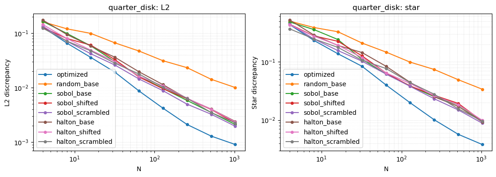
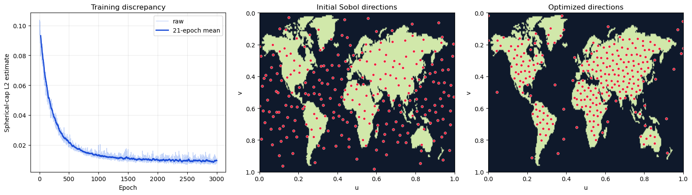

# Gradient-based Approximation of Nonuniform Low-Discrepancy Samples

[English](README.md) | 简体中文

本仓库是 **SIGGRAPH 2026（Conference Papers）** 论文 **《Gradient-based Approximation of Nonuniform Low-Discrepancy Samples》** 的开源代码库。论文作者为 Xiangyu Li、Ege Ciklabakkal、Daniel Ritchie 和 Toshiya Hachisuka。本仓库提供用于复现论文的独立二维和三维实现。

[论文全文（PDF）](https://cs.uwaterloo.ca/~thachisu/gradnuld.pdf) | [ACM / DOI](https://doi.org/10.1145/3799902.3811140)

## 优化结果示例

**二维：**四分之一圆目标下，优化点集与 QMC 基线的差异度对比。



**三维：**地球目标的训练损失曲线及优化前后的点集对比。



## 安装

建议使用 Python 3.10 或更高版本。以下命令均在本目录（`opensource/`）执行。
Bash 启动脚本需要 Bash 环境，例如 Git Bash 或 WSL。

```bash
python -m pip install -r requirements.txt
```

## 执行实验

二维：

```bash
bash 2d/scripts/run_uniform.sh
bash 2d/scripts/run_nonuniform.sh
bash 2d/scripts/run_qmc_baselines.sh
```

二维启动脚本默认使用 CUDA；修改脚本中的目标和参数后运行。
参见[二维 README](2d/README.md)。

三维：

```bash
bash 3d/scripts/run_uniform.sh
bash 3d/scripts/run_envmap.sh
bash 3d/scripts/run_cosine.sh
bash 3d/scripts/run_neural.sh --case brdf
bash 3d/scripts/run_neural.sh --case env
```

三维启动脚本支持追加参数，例如
`bash 3d/scripts/run_uniform.sh --device cpu --epochs 10`。
可通过 `PYTHON_BIN` 选择 Python 可执行文件（默认为 `python3`）。
启动脚本的结果分别保存在 `2d/data/` 和 `3d/data/optimized/`。
具体实验内容、参数、直接运行 Python 的命令、输出格式及测试方式见[三维 README](3d/README.md)。

## 打开 Notebook

```bash
jupyter lab 2d/notebooks/compare_2d_results.ipynb
jupyter lab 3d/notebooks/earth_fast_forward.ipynb
```

两个 Notebook 均保留了运行输出，可直接预览结果。

## 论文引用

如果使用本代码或基于本工作开展研究，请引用：

```bibtex
@inproceedings{10.1145/3799902.3811140,
author = {Li, Xiangyu and Ciklabakkal, Ege and Ritchie, Daniel and Hachisuka, Toshiya},
title = {Gradient-based Approximation of Nonuniform Low-Discrepancy Samples},
year = {2026},
isbn = {9798400725548},
publisher = {Association for Computing Machinery},
address = {New York, NY, USA},
url = {https://doi.org/10.1145/3799902.3811140},
doi = {10.1145/3799902.3811140},
booktitle = {Proceedings of the Special Interest Group on Computer Graphics and Interactive Techniques Conference Conference Papers},
articleno = {117},
numpages = {10},
series = {SIGGRAPH Conference Papers '26}
}
```
